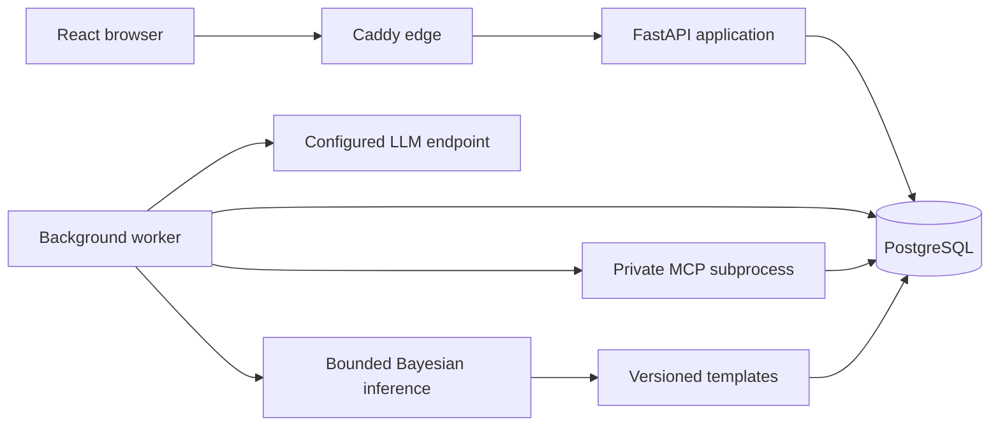

# X-INSIGHT

**A research prototype for exploring schizophrenia treatment options through
structured assessments, Bayesian networks, and physician review.**

[](https://keepthewhy.com)
[](LICENSE)

X-INSIGHT combines patient and encounter records with versioned clinical content,
drug–drug interaction (DDI) checks, and a traceable reasoning pipeline. An LLM
estimates conditional probability tables (CPTs); the application validates those
tables, executes the Bayesian networks, and renders recommendations from templates.
Physicians can inspect and adjust probabilities, compare results, and sign a
separate final treatment plan while retaining the original system proposal.

The application has an English desktop interface for one administrator and a small
physician team sharing a patient pool. It is designed for self-hosted Linux or VPS
deployment.

> **Research status:** X-INSIGHT is not release-ready or clinically validated and
> must not be used as the sole basis for treating patients. The release gate remains
> open; one-host deployment packaging does not provide high availability.

[Installation guide](docs/installation.md) · [Architecture](#architecture) ·
[Checks and tests](#checks-and-tests) · [Documentation](#documentation)

## Capabilities

| Area | Implemented surfaces |
| --- | --- |
| Patient records | Registration, search, shared signed charts, follow-up encounters, and archival administration |
| Assessments | Diagnosis, PANSS, C-SSRS, structured history, medications, and adverse-effect forms with explicit completeness states |
| Drafts and notes | Autosave, resume/discard, author-only clinical draft access, and attributed page notes |
| Decision support | Versioned XMLBIF networks, scoped patient inputs through private MCP, queued CPT estimation, validation, deterministic inference, and templated proposals |
| Probability review | Original/current CPT inspection, sliders with proportional redistribution, local recalculation, reset, comparison, and explicit result acceptance |
| Signed plans | Physician-edited final plans, atomic signing, immutable snapshots, and attributed addenda |
| Administration | Physician accounts, network versions and graph viewing, encrypted provider settings, audit views, exports, backups, staged restore, and operational status |

These interfaces do not imply that every content dependency is released or that
every acceptance check has passed. See the current boundaries below.

## Current engineering status

The latest implementation checkpoint is [S42, recorded on
2026-10-17](project-documents/dev/progress/s42.md), completed after the
[S62 release rehearsal](project-documents/dev/progress/s62.md). Current schema head
is `0021`; fresh backups include a 32-table inventory.

- **Provider administration is implemented.** Administrators can save encrypted
  credentials, inspect masked settings and revisions, and run capability checks.
  The generation worker still reads environment configuration; it does not consume
  saved provider settings or their credentials. Production Compose also needs
  deployment-key and allowed-host environment wiring.
- **Question-package approval is recorded.** All 11 `s39-reviewed-v1` packages have
  [explicit owner approval](content/questions/review-confirmation.s39-v1.json).
  Historical workflow bundles still reference predecessor drafts and require their
  own review and activation. History/instrument dependencies and the real DDI
  corpus retain their separate review requirements.
- **Release evidence is incomplete.** Provider runtime integration, content
  projection/integration, acceptance gaps, known test failures, and a fresh release
  rehearsal remain open. Live-provider behavior and latency have not been proven
  by the recorded rehearsal.

Use the [progress index](project-documents/dev/progress/README.md) and
[current release follow-up](project-documents/dev/progress/s62.md#follow-up-2026-10-18--documentation-assessment-and-next-work)
for the detailed handoff. Earlier reports describe their dated scope;
[tasks.md](project-documents/dev/tasks.md) currently ends at S62.

## Workflow and data boundaries

Registration proceeds through demographics, diagnosis, severity, suicide
assessment, history/medications, proposal review, and final-plan signing. Follow-up
starts from a signed baseline, reconciles current information, and adds adverse
effect assessment before proposal review and signing.

The core record and reasoning rules are:

- A patient has at most one open draft across all physicians and encounter types.
  Only its author can access its clinical content or edit, adjust, accept, discard,
  or sign it.
- Patient variables inform LLM estimation of every CPT, including root-node
  distributions. Bayesian inference then runs with an **empty evidence set**.
- Page notes do not enter prompts, patient projections, applicability rules,
  inference, or DDI checks. Unanswered assessments do not become zero or minimum
  scores.
- Slider changes recalculate locally without another LLM or MCP request. Original
  estimates and results remain available alongside adjusted revisions.
- Signing requires successful, current executions and acceptance of their current
  results. Failed initial generation has no manual-plan signing bypass.
- Signed records remain immutable. Corrections use attributed addenda; a later
  assessment is a new follow-up encounter.
- Runtime DDI checks use a versioned local knowledge base. Missing coverage is
  reported as unavailable rather than interpreted as an absence of interactions.

The [system design](project-documents/dev/system-design.md) defines the full
contract; [context/](context/index.md) records the reasoning behind key choices.

## Architecture

The system is a modular monolith with a separate background worker, private MCP
subprocesses, and one authoritative PostgreSQL database. In the packaged deployment,
Caddy serves the web bundle and proxies same-origin `/api` requests.



| Layer | Technology |
| --- | --- |
| Web | React, TypeScript, Vite |
| API and persistence | Python 3.12, FastAPI, Pydantic, SQLAlchemy, Alembic, psycopg |
| Reasoning | pgmpy, XMLBIF validation with lxml, private stdio MCP |
| Storage and deployment | PostgreSQL 16, Docker Compose, Caddy |
| Verification | pytest, Ruff, mypy, TypeScript, Playwright Chromium and Firefox |

Dependencies are pinned in [backend/uv.lock](backend/uv.lock),
[web/package-lock.json](web/package-lock.json), and the
[root package-lock.json](package-lock.json). Production image pins are maintained
in [deploy/](deploy/).

## Local development

Follow the [Installation and Running Guide](docs/installation.md) for prerequisites,
source checkout, local configuration, migrations, first login, the separate worker,
and troubleshooting. It also covers Docker deployment on a Linux host.

The local stack uses PostgreSQL containers and host API/Vite processes on ports
8000/5173. Load `.env` before `make dev`; migrations and the background worker are
separate steps. The guide explains the required terminal sequence and database-port
preflight. For shared deployment, use its Docker instructions and external
credentials file.

## Configuration

[.env.example](.env.example) lists the configuration placeholders.

| Variable | Purpose |
| --- | --- |
| `DATABASE_URL` | Application PostgreSQL connection |
| `TEST_DATABASE_URL` | Separate disposable database for backend/recovery tests |
| `DB_PORT`, `TEST_DB_PORT` | Host ports for local database containers |
| `X_INSIGHT_PROVIDER_ENDPOINT`, `X_INSIGHT_PROVIDER_MODEL` | Keyless fallback when a job has no saved settings revision; endpoint is the full provider POST URL |
| `X_INSIGHT_PROVIDER_CAPABILITY` | Response mode for generation: `schema` or `json`; defaults to `schema`. A `response_format` rejection is retried once without it |
| `X_INSIGHT_PROVIDER_DATA_KEY` | Operator-held AES-GCM key for stored provider credentials: base64 encoding of exactly 32 bytes; excluded from backups. Required to decrypt the key generation sends |
| `X_INSIGHT_PROVIDER_ALLOWED_HOSTS` | Exact hostnames allowed for saved settings, capability checks, and generation; comma-separated, empty denies all |
| `API_PROXY_TARGET` | Optional Vite API proxy override; defaults to `http://localhost:8000` |

An administrator saves the endpoint, model, and API key on the Provider page.
A queued generation uses the settings revision pinned when that job was
created, including the decrypted bearer, and refuses a destination that is
no longer allowlisted. Replacing or clearing the key cancels active
generation jobs. Local recalculation does not use the provider. The
environment endpoint is only the fallback for jobs queued before any
settings existed, and that fallback does not send a bearer token.

## Checks and tests

Load `.env` into the test shell using the export block above. Backend and recovery
tests need a reachable disposable `TEST_DATABASE_URL`; their Make targets do not
load `.env` themselves. Browser tests use the running API behind the web proxy,
so run them against a separate test API/database as well. Some recovery browser
scenarios replace database state.

Install the browser binaries once before browser checks:

```sh
npx playwright install chromium firefox
```

| Command | Scope |
| --- | --- |
| `make check` | Backend formatting, lint and types; web build; root TypeScript checks |
| `make test-backend` | Backend pytest suite |
| `make test-backend TEST=tests/http/test_health.py` | One selected backend test file |
| `make test-e2e` | Playwright suite in Chromium and Firefox |
| `make test-e2e TEST=e2e/smoke.spec.ts` | Selected browser smoke scenario |
| `make test-recovery` | Backend backup/restore suite under `tests/recovery` |
| `make test-load` | Synthetic load probe; configurable with `LOAD_PATIENTS`, `LOAD_WORKERS`, and `LOAD_REPORT` |
| `make verify` | Combined check, backend, and browser gate; no live provider credentials required |
| `make prod-check` | Production packaging self-check |

`make test-e2e` starts a Vite preview on port `5173`, which must be free. Its API
proxy defaults to port `8000`; set `API_PROXY_TARGET` for an isolated API.
`E2E_BASE_URL` changes the browser destination only. `make test-web` currently exits
with an explicit unimplemented-suite message.

These are the available verification commands, not a claim that the current tree
passes every gate. Recorded failures and unrun checks remain in the
[release handoff](project-documents/dev/progress/s62.md).

## Clinical content and DDI tooling

Clinical assets live under [content/](content/); supplied medical references and
Bayesian-network sources live under [project-documents/](project-documents/).
Track current approvals in the [content review ledger](content/review-ledger.md)
and the exact [question-package confirmation
manifest](content/questions/review-confirmation.s39-v1.json). Package approval,
workflow-bundle release, activation, and clinical validation are separate states.

The DDI CLI builds offline candidates independently of runtime lookup. From
`backend/`:

```sh
uv run python -m x_insight.ddi build \
  --sources ../project-documents/medical-documents/DDI-text \
  --terminology ../content/ddi/aliases.json \
  --output /tmp/x-insight-ddi-candidate
```

The last recorded corpus build had **26 structural failures across 128 documents**
and no approved aliases. It wrote candidate/report outputs and exited with status
`1`; it did not produce an approved corpus release. See
[S17](project-documents/dev/progress/s17.md) for terminology and validation evidence.

Publication requires an explicitly owner-reviewed manifest with decision
`approved_complete` or `approved_limited`:

```sh
uv run python -m x_insight.ddi publish \
  --staging /tmp/x-insight-ddi-candidate \
  --manifest /path/to/owner-reviewed-manifest.json
```

The bundled [manifest template](content/ddi/review-manifest.template.json) remains
`awaiting_review` and cannot authorize publication. Releases are content-addressed
and immutable; [S18](project-documents/dev/progress/s18.md) records the publication
contract and its synthetic verification scope.

## Deployment and recovery

Follow [deploy/README.md](deploy/README.md) for the one-host install, environment
setup, HTTPS, upgrades, schema compatibility, backup, staged restore, and rollback.
[compose.prod.yaml](compose.prod.yaml) packages `edge`, `app`, `worker`, `db`, and a
one-off migration service. Only the edge is externally exposed.

The recorded rehearsal verified selected installation, image-build, and recovery
steps; it did not establish release readiness. Use the
[installation guide](docs/installation.md#docker-deployment-on-linux) for setup and
credentials-file handling, and the
[current provider checkpoint](project-documents/dev/progress/s42.md) for outstanding
runtime/environment integration. Keep the deployment encryption key separately
from backup archives.

## Repository layout

```text
backend/             FastAPI modules, migrations, CLI tools, and pytest suites
web/                 React application and shared styles
content/             Versioned assessments, history, question packages, bundles, DDI
e2e/                 Playwright browser scenarios
deploy/              Dockerfiles, Caddy configuration, and operator runbook
docs/                Installation and running instructions
project-documents/   Requirements, design, planning, source material, and progress
context/             Decision rationale maintained with Keep the Why
compose.yaml         Local development and test databases
compose.prod.yaml    One-host deployment services
Makefile             Development, verification, and deployment commands
```

## Documentation

| Start here for… | Reference |
| --- | --- |
| Installation, configuration, and startup | [Installation and Running Guide](docs/installation.md) |
| Recorded progress and the next handoff | [Progress index](project-documents/dev/progress/README.md) |
| Product scope and requirements | [User requirements](project-documents/dev/user-requirements.md) |
| Behavior and architectural contracts | [System design](project-documents/dev/system-design.md), [system architecture](project-documents/dev/system-architecture.md) |
| Implementation policy and scheduled work | [Plan](project-documents/dev/plan.md), [tasks](project-documents/dev/tasks.md) |
| Clinical asset review and approval | [Content review ledger](content/review-ledger.md) |
| Installation, upgrades, and recovery | [Operator runbook](deploy/README.md) |
| Why key decisions were made | [Context index](context/index.md) |
| Agent contribution instructions | [AGENTS.md](AGENTS.md) |

Before contributing, read the progress index and the relevant checkpoint/handoff,
then follow the implementation plan. Record new progress in the appropriate report
and keep the index short. The project uses [Keep the Why](https://keepthewhy.com)
to preserve decision rationale alongside procedural documentation.

## License

The project is licensed under the [MIT License](LICENSE).
