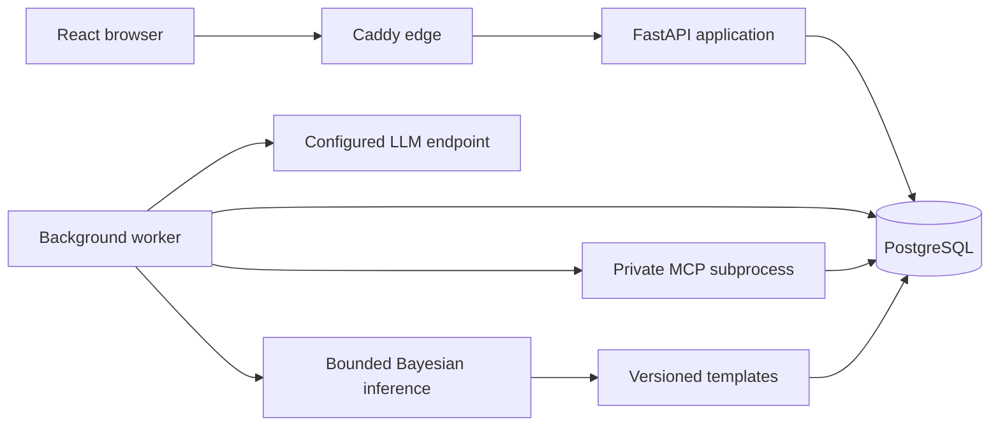

# X-INSIGHT

**A research prototype for exploring schizophrenia treatment options through
structured assessments, Bayesian networks, and physician review.**

[](https://keepthewhy.com)
[](LICENSE)

X-INSIGHT combines patient and encounter records with versioned clinical content,
drug–drug interaction (DDI) checks, and a traceable reasoning pipeline. An LLM
estimates conditional probability tables (CPTs); the application validates those
tables, executes the Bayesian networks, and renders recommendations from templates.
Physicians can inspect and adjust probabilities, compare results, and sign a
separate final treatment plan while retaining the original system proposal.

The application has an English desktop interface for one administrator and a small
physician team sharing a patient pool. It is designed for self-hosted Linux or VPS
deployment.

> **Research status:** X-INSIGHT is not release-ready or clinically validated and
> must not be used as the sole basis for treating patients. The release gate remains
> open; one-host deployment packaging does not provide high availability.

[Installation guide](docs/installation.md) · [Architecture](#architecture) ·
[Checks and tests](#checks-and-tests) · [Documentation](#documentation)

## Capabilities

| Area | Implemented surfaces |
| --- | --- |
| Patient records | Registration, search, shared signed charts, follow-up encounters, and archival administration |
| Assessments | Diagnosis, PANSS, C-SSRS, structured history, medications, and adverse-effect forms with explicit completeness states |
| Drafts and working note | Autosave, resume/discard, author-only clinical draft access, and an editable working note on Register patient |
| Decision support | Versioned XMLBIF networks, scoped patient inputs through private MCP, queued CPT estimation, validation, deterministic inference, and templated proposals |
| Probability review | Original/current CPT inspection, sliders with proportional redistribution, local recalculation, reset, comparison, and explicit result acceptance |
| Signed plans | Physician-edited final plans, atomic signing, immutable snapshots, and attributed addenda |
| Administration | Physician accounts, network versions and graph viewing, encrypted provider settings, audit views, exports, backups, staged restore, and operational status |

These interfaces do not imply that every content dependency is released or that
every acceptance check has passed. See the current boundaries below.

## Current engineering status

The [2026-10-22 History input follow-up](project-documents/dev/progress/s12.md#follow-up-2026-10-22--lai-aggression-and-c-ssrs-input-cleanup)
removes the duplicate high-suicide History questions and carries the completed
Step 4 C-SSRS assessment into generation. LAI and aggression inputs use the revised
choices, Unknown defaults and conditional NMS question. The seven conditional core
questions and preceding pharmacotherapy cleanup remain in place. See the
[current History contract](docs/proposal-generation.md#complete-proposal-context)
for choices, readiness and older-run recovery. Changed input contracts await review;
original package approval does not approve these changes.

The preceding [proposal-readiness fix](project-documents/dev/progress/s48.md#follow-up-2026-10-22--check-proposal-readiness-before-creating-a-run)
checks saved required context before Step 7 creates a run, lists all blockers
with links to their History controls, and keeps core History completion separate.
See [proposal generation](docs/proposal-generation.md) for recovery and API details.

The preceding bounded follow-up implements the complete supplied DDInter import and
[medication workflow integration (2026-10-21)](project-documents/dev/progress/s20.md#follow-up-2026-10-21--ddinter-workflow-and-release-association).
The owner confirmed completed review, and release `ddi-c45e2051cf16` is
[published into the local application database](docs/verification/ddinter-2026-10-21/publication.md).
The [automatic-startup follow-up (2026-10-23)](project-documents/dev/progress/s18.md#follow-up-2026-10-23--prepare-schema-and-ddinter-during-normal-startup)
installs that same approved release during `make dev` or `make prod-up` when a
database has no released DDI dataset. Its committed sources rebuild offline;
normal startup needs no separate migration or manual publication command.
The earlier [page-note follow-up](project-documents/dev/progress/s13.md#follow-up-2026-10-20--remove-page-notes-keep-the-working-note)
preserves the working note.
The latest provider-security implementation follow-up is [S42, updated
2026-10-26](project-documents/dev/progress/s42.md#follow-up-2026-10-26--provider-onboarding-and-destination-safety).
It removes the mandatory public-host setup, provisions a persistent deployment
key, and enforces destination checks at the outbound connection. Schema head is
`0024`; encrypted provider credentials are included in database backups, while
the deployment encryption key is stored separately and excluded.

- **Provider administration and runtime integration are implemented.** An
  administrator can save a public HTTPS provider using its URL, model, and API
  key without editing an environment allowlist. The worker uses the job's pinned
  settings revision. A persistent random deployment key is provisioned at
  startup; existing managed keys are preserved across restarts and are required
  to recover encrypted settings. Local HTTP endpoints and the `198.18.0.0/15`
  transparent-proxy range require explicit persisted approval. A nonempty
  `X_INSIGHT_PROVIDER_ALLOWED_HOSTS` remains an optional restrictive policy.
- **Question-package approval is recorded.** All 11 `s39-reviewed-v1` packages have
  [explicit owner approval](content/questions/review-confirmation.s39-v1.json).
  The separately owner-confirmed active workflow release pins these packages;
  historical bundles retain their earlier review states. See
  [proposal generation](docs/proposal-generation.md) for the release contract.
- **Release evidence is incomplete.** Content projection/integration, acceptance
  gaps, known test failures, and a fresh release rehearsal remain open. No live
  paid-provider request, full-repository suite, or clinical validation is claimed.

Use the [progress index](project-documents/dev/progress/README.md) and
[current release follow-up](project-documents/dev/progress/s62.md#follow-up-2026-10-18--documentation-assessment-and-next-work)
for the detailed handoff. Earlier reports describe their dated scope;
[tasks.md](project-documents/dev/tasks.md) currently ends at S62.

## Workflow and data boundaries

Registration (`#/patients/new` and a registration draft) is seven steps:
Register patient, Diagnosis, PANSS, C-SSRS, History, Medications, and Proposal
review, then final-plan signing. Adverse effects are not a registration step.
Follow-up starts from a signed baseline and reconciles current information; its
seven steps are Diagnosis, PANSS, C-SSRS, History, Adverse effects, Medications,
and Proposal review, before final-plan signing. The same section can show a
different step number by encounter kind. The
[2026-10-18 follow-up](project-documents/dev/progress/s07.md#follow-up-2026-10-18--adverse-effects-leave-the-registration-wizard)
records the refusal contract.

The core record and reasoning rules are:

- A patient has at most one open draft across all physicians and encounter types.
  Only its author can access its clinical content or edit, adjust, accept, discard,
  or sign it.
- Patient variables inform LLM estimation of every CPT, including root-node
  distributions. Bayesian inference then runs with an **empty evidence set**.
- The Register patient working note autosaves once a draft exists and does not
  enter prompts, patient projections, applicability rules, inference, or DDI
  checks. Page-note controls and routes have been removed. Unanswered assessments
  do not become zero or minimum scores.
- Slider changes recalculate locally without another LLM or MCP request. Original
  estimates and results remain available alongside adjusted revisions.
- Signing requires successful, current executions and acceptance of their current
  results. Failed initial generation has no manual-plan signing bypass.
- Signed records remain immutable. Corrections use attributed addenda; a later
  assessment is a new follow-up encounter.
- Runtime DDI checks use a versioned local knowledge base. Missing coverage is
  reported as unavailable rather than interpreted as an absence of interactions.

New signatures use `signed-encounter-v2` without a page-notes field, and printable
reports omit page notes. Historical note storage and existing v1 signed payloads
and hashes remain intact for record and backup compatibility. This change adds
no migration; the later DDInter migration advances schema head to `0022` while
retaining 32 backup tables.

The [system design](project-documents/dev/system-design.md) defines the full
contract; [context/](context/index.md) records the reasoning behind key choices.

## Architecture

The system is a modular monolith with a separate background worker, private MCP
subprocesses, and one authoritative PostgreSQL database. In the packaged deployment,
Caddy serves the web bundle and proxies same-origin `/api` requests.



| Layer | Technology |
| --- | --- |
| Web | React, TypeScript, Vite |
| API and persistence | Python 3.12, FastAPI, Pydantic, SQLAlchemy, Alembic, psycopg |
| Reasoning | pgmpy, XMLBIF validation with lxml, private stdio MCP |
| Storage and deployment | PostgreSQL 16, Docker Compose, Caddy |
| Verification | pytest, Ruff, mypy, TypeScript, Playwright Chromium and Firefox |

Dependencies are pinned in [backend/uv.lock](backend/uv.lock),
[web/package-lock.json](web/package-lock.json), and the
[root package-lock.json](package-lock.json). Production image pins are maintained
in [deploy/](deploy/).

## Local development

Follow the [Installation and Running Guide](docs/installation.md) for prerequisites,
source checkout, local configuration, automatic setup, first login, the separate worker,
and troubleshooting. It also covers Docker deployment on a Linux host.

After configuring `.env`, run `make dev`. It loads the configuration, waits for
PostgreSQL, prepares schema and approved DDI data, then starts the API and Vite
on ports 8000/5173 by default. The background worker remains a separate local
process. For shared deployment, follow the guide's Docker instructions and run
`make prod-up` after building images; production startup prepares data before
starting the API and worker.

Startup provisions the bundled owner-approved DDInter dataset: **1,939 drugs and
222,383 source occurrences**. The first offline
rebuild/import may take several minutes; wait for `READY: ddi-c45e2051cf16` before
using Medications. Repeated setup reuses the immutable release. Existing deployments
retain their released dataset; see the [bootstrap rules](docs/ddinter-operations.md#fresh-installation-with-the-bundled-approved-release).

## Configuration

[.env.example](.env.example) lists the configuration placeholders.

| Variable | Purpose |
| --- | --- |
| `DATABASE_URL` | Application PostgreSQL connection |
| `DDI_DEFAULT_DATASET_VERSION` | Optional existing immutable DDI default; invalid versions fail explicitly; encounter pins/selection associations take precedence |
| `TEST_DATABASE_URL` | Separate disposable database for backend/recovery tests |
| `DB_PORT`, `TEST_DB_PORT` | Host ports for local database containers |
| `X_INSIGHT_PROVIDER_ENDPOINT`, `X_INSIGHT_PROVIDER_MODEL` | Keyless fallback when a job has no saved settings revision; endpoint is the full provider POST URL |
| `X_INSIGHT_PROVIDER_CAPABILITY` | Response mode for generation: `schema` or `json`; defaults to `schema`. A `response_format` rejection is retried once without it |
| `X_INSIGHT_PROVIDER_DATA_KEY` | Optional existing deployment AES-GCM key override, base64 encoding of exactly 32 bytes; excluded from backups. Preserve the matching key to recover encrypted credentials |
| `X_INSIGHT_PROVIDER_DATA_KEY_FILE` | Optional protected key-file path; local default is `backend/.secrets/provider-data.key`. Normal startup creates a random key once if none exists |
| `X_INSIGHT_PROVIDER_ALLOWED_HOSTS` | Optional comma-separated exact-host restriction for saved providers. Unset/blank allows eligible public HTTPS destinations; a nonempty list restricts them |
| `API_PROXY_TARGET` | Optional Vite API proxy override; defaults to `http://localhost:8000` |

An administrator saves the endpoint, model, and API key on the Provider page.
A queued generation uses the settings revision pinned when that job was
created, including the decrypted bearer, and validates and pins resolved public
addresses for each outbound request. An origin URL maps to
`/v1/chat/completions`; a URL ending in `/v1` gets that suffix; an explicitly
supplied full/custom endpoint is preserved and shown as the effective endpoint.
Only an explicitly approved local endpoint may use HTTP, and it must resolve to
local addresses. Metadata, link-local, and unspecified targets remain blocked.
Replacing or clearing the key cancels active generation jobs. Local
recalculation does not use the provider. The
environment endpoint is only the fallback for jobs queued before any
settings existed, and that fallback does not send a bearer token.

## Checks and tests

Load `.env` into the test shell using the export block above. Backend and recovery
tests need a reachable disposable `TEST_DATABASE_URL`; their Make targets do not
load `.env` themselves. Browser tests use the running API behind the web proxy,
so run them against a separate test API/database as well. Some recovery browser
scenarios replace database state.

Install the browser binaries once before browser checks:

```sh
npx playwright install chromium firefox
```

| Command | Scope |
| --- | --- |
| `make check` | Backend formatting, lint and types; web build; root TypeScript checks |
| `make test-backend` | Backend pytest suite |
| `make test-backend TEST=tests/http/test_health.py` | One selected backend test file |
| `make test-e2e` | Playwright suite in Chromium and Firefox |
| `make test-e2e TEST=e2e/smoke.spec.ts` | Selected browser smoke scenario |
| `bash e2e/run-ddi-fresh-install.sh` | Isolated PostgreSQL 16 setup and real bundled-DDInter registration in Chromium and Firefox; see [prerequisites](docs/ddinter-operations.md#fresh-install-verification) |
| `make test-recovery` | Backend backup/restore suite under `tests/recovery` |
| `make test-load` | Synthetic load probe; configurable with `LOAD_PATIENTS`, `LOAD_WORKERS`, and `LOAD_REPORT` |
| `make verify` | Combined check, backend, and browser gate; no live provider credentials required |
| `make prod-check` | Production packaging self-check |

`make test-e2e` starts a Vite preview on port `5173`, which must be free. Its API
proxy defaults to port `8000`; set `API_PROXY_TARGET` for an isolated API.
`E2E_BASE_URL` changes the browser destination only. `make test-web` currently exits
with an explicit unimplemented-suite message.

These are the available verification commands, not a claim that the current tree
passes every gate. Recorded failures and unrun checks remain in the
[release handoff](project-documents/dev/progress/s62.md).

## Clinical content and DDI tooling

Clinical assets live under [content/](content/); supplied medical references and
Bayesian-network sources live under [project-documents/](project-documents/).
Track current approvals in the [content review ledger](content/review-ledger.md)
and the exact [question-package confirmation
manifest](content/questions/review-confirmation.s39-v1.json). Package approval,
workflow-bundle release, activation, and clinical validation are separate states.

Normal setup installs the existing owner-approved DDInter release automatically;
the DDI CLI also builds offline candidates independently of runtime lookup.

For the complete supplied DDInter CSV release, follow the
[DDInter operations runbook](docs/ddinter-operations.md) for build, owner review,
privileged publication, verification, default selection, and rollback. The
[earlier acceptance evidence](docs/verification/ddinter-2026-10-21/README.md) covers
all 1,939 IDs and 222,383 occurrences in isolated databases. The subsequent
[owner-confirmed publication](docs/verification/ddinter-2026-10-21/publication.md)
records the local application release, target checks and backups. Its severity-only
positive assertions retain unavailable pair coverage. The monograph path below
remains separate. From `backend/`:

```sh
uv run python -m x_insight.ddi build \
  --sources ../project-documents/medical-documents/DDI-text \
  --terminology ../content/ddi/aliases.json \
  --output /tmp/x-insight-ddi-candidate
```

The last recorded corpus build had **26 structural failures across 128 documents**
and no approved aliases. It wrote candidate/report outputs and exited with status
`1`; it did not produce an approved corpus release. See
[S17](project-documents/dev/progress/s17.md) for terminology and validation evidence.

Publication requires an explicitly owner-reviewed manifest with decision
`approved_complete` or `approved_limited`:

```sh
uv run python -m x_insight.ddi publish \
  --staging /tmp/x-insight-ddi-candidate \
  --manifest /path/to/owner-reviewed-manifest.json
```

The bundled [manifest template](content/ddi/review-manifest.template.json) remains
`awaiting_review` and cannot authorize publication. Releases are content-addressed
and immutable; [S18](project-documents/dev/progress/s18.md) records the publication
contract and its synthetic verification scope.

## Deployment and recovery

Follow [deploy/README.md](deploy/README.md) for the one-host install, environment
setup, HTTPS, upgrades, schema compatibility, backup, staged restore, and rollback.
[compose.prod.yaml](compose.prod.yaml) packages `edge`, `app`, `worker`, `db`, and a
one-off setup service that must succeed before the API and worker start. Only
the edge is externally exposed.

The recorded rehearsal verified selected installation, image-build, and recovery
steps; it did not establish release readiness. Use the
[installation guide](docs/installation.md#docker-deployment-on-linux) for setup and
credentials-file handling, and the
[current provider checkpoint](project-documents/dev/progress/s42.md) for provider
security behavior and verification limits. The deployment encryption key is
stored in a persistent secret volume and is excluded from backup archives;
escrow the original key separately so encrypted settings remain recoverable.

## Repository layout

```text
backend/             FastAPI modules, migrations, CLI tools, and pytest suites
web/                 React application and shared styles
content/             Versioned assessments, history, question packages, bundles, DDI
e2e/                 Playwright browser scenarios
deploy/              Dockerfiles, Caddy configuration, and operator runbook
docs/                Installation and running instructions
project-documents/   Requirements, design, planning, source material, and progress
context/             Decision rationale maintained with Keep the Why
compose.yaml         Local development and test databases
compose.prod.yaml    One-host deployment services
Makefile             Development, verification, and deployment commands
```

## Documentation

| Start here for… | Reference |
| --- | --- |
| Using the app as a physician or administrator | [User Guide](docs/user-guide.md) |
| Installation, configuration, and startup | [Installation and Running Guide](docs/installation.md) |
| Recorded progress and the next handoff | [Progress index](project-documents/dev/progress/README.md) |
| Product scope and requirements | [User requirements](project-documents/dev/user-requirements.md) |
| Behavior and architectural contracts | [System design](project-documents/dev/system-design.md), [system architecture](project-documents/dev/system-architecture.md) |
| Implementation policy and scheduled work | [Plan](project-documents/dev/plan.md), [tasks](project-documents/dev/tasks.md) |
| Clinical asset review and approval | [Content review ledger](content/review-ledger.md) |
| Installation, upgrades, and recovery | [Operator runbook](deploy/README.md) |
| DDInter build, review, publish, and default rollback | [DDInter operations](docs/ddinter-operations.md) |
| Proposal readiness, generation, and existing-run recovery | [Proposal generation](docs/proposal-generation.md) |
| Why key decisions were made | [Context index](context/index.md) |
| Agent contribution instructions | [AGENTS.md](AGENTS.md) |

Before contributing, read the progress index and the relevant checkpoint/handoff,
then follow the implementation plan. Record new progress in the appropriate report
and keep the index short. The project uses [Keep the Why](https://keepthewhy.com)
to preserve decision rationale alongside procedural documentation.

## License

The project is licensed under the [MIT License](LICENSE).
